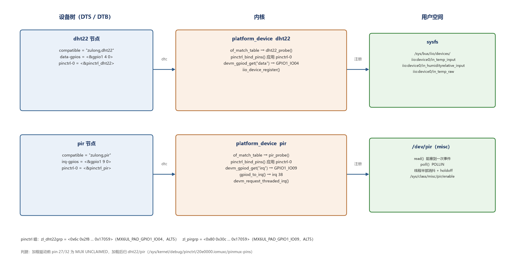

# 系列文章草稿与发布约定

本目录是「i.MX6ULL 驱动笔记」的 markdown 草稿，仓库里保持**相对路径**（GitHub 能点开）。
发 CSDN 时要手动改两处，否则线上是断的：

## 发布检查清单

```text
1. 图片
   正文里  这种相对路径，CSDN 编辑器不解析，
   会留下一行“外链图片转存失败”的占位。必须手动上传图片再插图，
   然后把那一行占位删掉。

2. 文内链接
   b00 ↔ b01、09 的回链，仓库里写的是相对路径或占位链接。
   发布后要把它们换成 CSDN 的绝对 URL：
     00  https://blog.csdn.net/longlin101/article/details/170550740
     01  https://blog.csdn.net/longlin101/article/details/170550878

3. 标签
   CSDN 会根据正文自动选标签，经常选成 stm32/单片机。
   手动改成：Linux、i.MX6ULL、设备树、内核模块、驱动开发

4. 代码块
   贴进编辑器后确认语言标记还在（bash / c / dts / text），
   否则会掉高亮。
```

## 已发布

```text
B00 这个系列写什么
    https://blog.csdn.net/longlin101/article/details/170550740
B01 把 insmod 的 gpio_num 换成设备树
    https://blog.csdn.net/longlin101/article/details/170550878

前置（A 系列 09）
    https://blog.csdn.net/longlin101/article/details/170347113
```

## 待写

```text
B02 IIO buffer / trigger
B03 用 regmap / gpiod 把驱动写规范
B04 Buildroot 集成，开机自动加载
```
