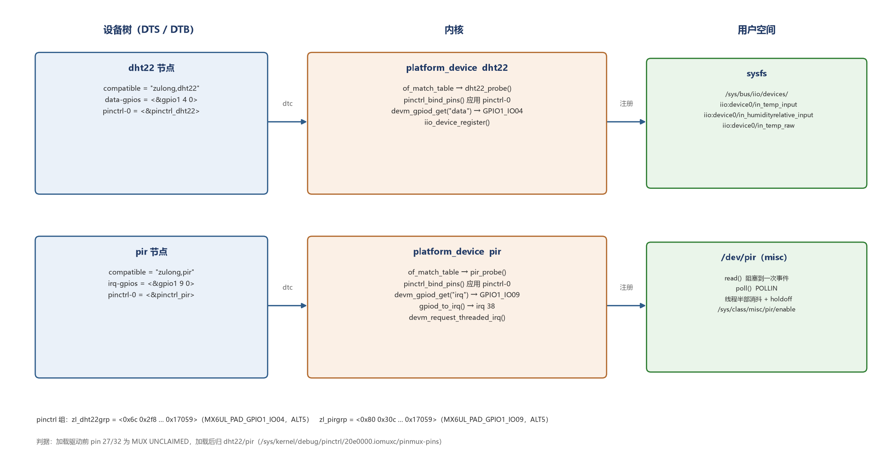

# i.MX6ULL 驱动笔记（01）：把 `insmod` 的 gpio_num 换成设备树

> 系列目录：[00 这个系列写什么](https://blog.csdn.net/longlin101/article/details/170550740)
> 前置：[09 i.MX6ULL 驱动：DHT22 IIO + PIR 字符设备](https://blog.csdn.net/longlin101)（单总线时序、交叉编译、模块加载）
> 代码：[imx6ull-dht22-pir-drivers](https://github.com/longlin05/imx6ull-dht22-pir-drivers)
> 已发布：https://blog.csdn.net/longlin101/article/details/170550878

---

## 0. 从哪一步开始不对

09 最后跑通的用法是这样的：

```bash
insmod dht22_iio.ko gpio_num=4
insmod pir_gpio.ko gpio_num=9 debounce_ms=200 holdoff_ms=3000
```

能读到数，但这份驱动离开这台机器就没法用：引脚号是**人肉查出来的全局 GPIO 编号**，
换一块板、换一个引脚就要重新数；上电不会自动加载；pinctrl 复用是芯片复位默认值，
没人保证它一直是对的。

目标很明确：

```text
设备树描述引脚 → platform_driver probe 时自动申请 → insmod 不带参数
```

但第一步不是改代码，是先搞清楚**板子到底跑的是哪份 DTB**。

## 1. 先确认板子跑的哪份 DTS

```bash
$ cat /proc/device-tree/compatible
fsl,imx6ull-14x14-evk fsl,imx6ull

$ cat /proc/device-tree/model
Freescale i.MX6 ULL 14x14 EVK Board
```

看起来就是 NXP 的 `imx6ull-14x14-evk`。但再往下看一层就不对了：

```bash
$ ls /proc/device-tree | tr '\n' ' '
aliases backlight chosen clocks compatible cpus dht11 ds18b20
gpio_keys@0 interrupt-controller@00a01000 leds memory model name
pxp_v4l2 regulators reserved-memory sii902x-reset soc sound spi4
```

`dht11`、`ds18b20`、`pxp_v4l2`、`sii902x-reset` 这些**不是 NXP 原版 EVK 的节点**，
是正点原子加的。看属性更明显：

```text
/proc/device-tree/dht11/compatible   = "alientek,dht11"
/proc/device-tree/dht11/dht11-gpio   = <&gpio1 1 GPIO_ACTIVE_LOW>
```

结论：**板子跑的是厂商改过的 EVK DTB**，而且改得不少（屏参、背光、音频、摄像头）。

## 2. 为什么不能直接改内核源码里的 dts

手头的内核树是 `linux-imx-rel_imx_4.1.15_2.1.0_ga`——NXP 官方 release 的命名，
里面的 `arch/arm/boot/dts/imx6ull-14x14-evk.dts` 是**原版**，没有上面那些 alientek 节点。

而且当初为了让模块能加载，还手工改过 `CONFIG_LOCALVERSION` 去对齐板子的
`4.1.15-g3dc0a4b`（模块 vermagic 必须完全一致）。也就是说：

```text
这棵源码树是为了拿 Module.symvers 另外下的，不是板子内核的构建树
```

用它重编 DTB，会得到一个**没有厂商屏参、没有 alientek 节点**的设备树。
能引导，但显示、音频、摄像头大概率全坏——而板子上没有串口控制台可救，
只能拔 SD 卡。

所以路子反过来：**以板子自己的 DTB 为基底**，加完节点再编回去。

## 3. 把 DTB 挖出来

板子的启动分区是 SD 卡第一个分区（vfat），里面放着内核和设备树：

```bash
$ ls /run/media/mmcblk1p1/
imx6ull-14x14-emmc-10.1-1280x800-c.dtb
imx6ull-14x14-emmc-4.3-480x272-c.dtb
imx6ull-14x14-emmc-4.3-800x480-c.dtb
imx6ull-14x14-emmc-7-1024x600-c.dtb
imx6ull-14x14-emmc-7-800x480-c.dtb
imx6ull-14x14-emmc-hdmi.dtb
imx6ull-14x14-emmc-vga.dtb
zImage
```

七个 DTB，分别对应不同屏幕。**到底是哪一个？** 不用猜，看 framebuffer：

```bash
$ cat /sys/class/graphics/fb0/modes
U:480x272p-56
```

板上插的是 4.3 寸 480×272 屏，所以就是 `imx6ull-14x14-emmc-4.3-480x272-c.dtb`。
（顺便说明：这台板子**没有** `fw_printenv`，u-boot 环境变量在 Linux 侧改不了，
文件名只能靠这种方式反推。）

拷回 PC 反编译：

```bash
dtc -I dtb -O dts -o board.dts imx6ull-14x14-emmc-4.3-480x272-c.dtb
```

得到的是一棵完整的、已经展开的树（3000 多行），节点、属性、phandle 都在。

## 4. 加节点：pin 号不是猜的

这一步是整个改造里最容易出错的地方。反编译出来的 dts 里，
`iomuxc` 的 pin 配置长这样（数字而不是宏，因为宏在编译成 dtb 时已经展开了）：

```dts
gpio-leds {
    fsl,pins = <0x68 0x2f4 0x00 0x05 0x00 0x17059>;
};
```

`0x68` 是什么引脚？靠记忆里的 `MX6UL_PAD_GPIO1_IO04` 是 `0x0068` 这种表去对，
**很容易错一位**（我一开始就错了：`0x68` 其实是 GPIO1_IO03）。

正确的做法是从运行时反推。`/sys/kernel/debug/pinctrl/` 会告诉我们每个 pin 的
编号和归属：

```bash
$ grep -E "pin (26|27|31|32) " /sys/kernel/debug/pinctrl/20e0000.iomuxc/pinmux-pins
pin 26 (MX6UL_PAD_GPIO1_IO03): leds (GPIO UNCLAIMED) function imx6ul-evk group gpio-leds
pin 27 (MX6UL_PAD_GPIO1_IO04): (MUX UNCLAIMED) (GPIO UNCLAIMED)
pin 31 (MX6UL_PAD_GPIO1_IO08): 2080000.pwm (GPIO UNCLAIMED) function imx6ul-evk group pwm1grp
pin 32 (MX6UL_PAD_GPIO1_IO09): (MUX UNCLAIMED) (GPIO UNCLAIMED)
```

再拿 dts 里对应的组做交叉验证：

```text
gpio-leds 组用的是 0x68  → 运行时是 pin 26（GPIO1_IO03）→ 0x68 / 4 = 26
pwm1grp 组用的是 0x7c    → 运行时是 pin 31（GPIO1_IO08）→ 0x7c / 4 = 31
uart1grp 用 0x84 / 0x88  → 运行时是 pin 33 / 34
```

规律成立：**pin_id = 4 × pinctrl 内部编号**。

于是我们要的两个脚：

```text
GPIO1_IO04 → pin 27 → 0x6c，mux 寄存器 0x2f8
GPIO1_IO09 → pin 32 → 0x80，mux 寄存器 0x30c
```

同时确认这两条在运行时是 `MUX UNCLAIMED`——没有被别的驱动占着，
可以直接用。顺带发现两件事：

```text
厂商的 dht11/ds18b20 节点用的是 GPIO1_IO01（0x60），不冲突
PWM 背光在 GPIO1_IO08（0x7c），也不冲突
```

节点和 pinctrl 组按这个写（pad 配置值 `0x17059` 直接沿用厂商 dht11 组：
迟滞开、47k 上拉、50MHz、快速翻转）：

```dts
&{/soc/aips-bus@02000000/iomuxc@020e0000/imx6ul-evk} {
	pinctrl_dht22: zl_dht22grp {
		fsl,pins = <0x6c 0x2f8 0x00 0x05 0x00 0x17059>;
	};
	pinctrl_pir: zl_pirgrp {
		fsl,pins = <0x80 0x30c 0x00 0x05 0x00 0x17059>;
	};
};

/ {
	dht22 {
		compatible = "zulong,dht22";
		pinctrl-names = "default";
		pinctrl-0 = <&pinctrl_dht22>;
		data-gpios = <&{/soc/aips-bus@02000000/gpio@0209c000} 0x04 0x00>;
		status = "okay";
	};

	pir {
		compatible = "zulong,pir";
		pinctrl-names = "default";
		pinctrl-0 = <&pinctrl_pir>;
		irq-gpios = <&{/soc/aips-bus@02000000/gpio@0209c000} 0x09 0x00>;
		status = "okay";
	};
};
```

反编译出来的 dts 没有标签，所以用 `&{/路径}` 引用已有节点；
`compatible` 用自己的前缀（`zulong,`），避免和厂商驱动撞。

## 5. 重编，但先立两道自检

`dtc` 反编译再编回去，理论上无损，但"理论上"不够——这块 DTB 是启动用的，
编坏了板子起不来。所以 `dts/build.sh` 里加了两道检查：

```text
1. 原 dts 原样编回去、再反编译，必须和第一次反编译的结果逐字一致
   → 证明这版 dtc 的往返是无损的，不会悄悄丢属性
2. 打补丁之后反编译，和原结果 diff：只允许有新增行，不能有删除行
   → 证明只加了节点，没动任何既有内容
```

这次的结果：

```text
自检通过：dtc 往返无损
差异：新增 26 行，删除 0 行
生成：39854 字节（原 39459 字节）
```

## 6. 刷入与回退

原本想用 `fw_setenv fdt_file xxx-b.dtb` 切到新文件，出问题只改回环境变量。
但这块板子的 rootfs 里**没有 fw_printenv**，u-boot 环境变量从 Linux 侧碰不到。
所以只能同名覆盖：

```bash
# 板子上先备份
cp -p /run/media/mmcblk1p1/imx6ull-14x14-emmc-4.3-480x272-c.dtb \
      /run/media/mmcblk1p1/imx6ull-14x14-emmc-4.3-480x272-c.dtb.bak
# PC 上传新文件，校验 md5 后再重启
scp out/imx6ull-14x14-emmc-4.3-480x272-c.dtb root@board:/run/media/mmcblk1p1/
```

回退方式：仓库 `dts/base/` 里存了原版 DTB，拷回 SD 卡启动分区即可
（需要读卡器）。

重启后先看这几样：

```bash
$ ls /proc/device-tree | grep -E "dht22|pir"
dht22
pir
$ cat /sys/class/graphics/fb0/modes
U:480x272p-56          # 屏参没被破坏
```

启动日志里那几条 `mxsfb ... failed to find mxc display driver`、
`ap3216c ... failed` 在刷之前就存在，不是这次引入的——**改设备树前后都要看 dmesg 做对比**。

## 7. 驱动改造

先把整条路画出来，后面每个箭头都会对上一段代码：



两个驱动都从 `module_init` 里的手工申请，改成 platform driver。

```c
static const struct of_device_id dht22_of_match[] = {
    { .compatible = "zulong,dht22" },
    { }
};
MODULE_DEVICE_TABLE(of, dht22_of_match);

static struct platform_driver dht22_driver = {
    .probe = dht22_probe,
    .remove = dht22_remove,
    .driver = { .name = "dht22", .of_match_table = dht22_of_match },
};
```

probe 里用 `devm_*` 拿资源，remove 里只剩注销：

```c
indio_dev = devm_iio_device_alloc(&pdev->dev, sizeof(*st));
st->data = devm_gpiod_get(&pdev->dev, "data", GPIOD_IN);   /* data-gpios */
...
ret = iio_device_register(indio_dev);
```

pinctrl 不用自己调——设备树里有 `pinctrl-0`，驱动核心在 probe 之前就应用了：

```bash
$ grep -E "pin (27|32) " /sys/kernel/debug/pinctrl/20e0000.iomuxc/pinmux-pins
pin 27 (MX6UL_PAD_GPIO1_IO04): dht22 (GPIO UNCLAIMED) function imx6ul-evk group zl_dht22grp
pin 32 (MX6UL_PAD_GPIO1_IO09): pir   (GPIO UNCLAIMED) function imx6ul-evk group zl_pirgrp
```

加载驱动前是 `MUX UNCLAIMED`，加载后归属变成 dht22 / pir——
这条命令就是"pinctrl 到底生效没有"的判据。

PIR 那边还顺手把定时器消抖换成了 threaded IRQ：

```c
static irqreturn_t pir_hardirq(int irq, void *data)
{
    return IRQ_WAKE_THREAD;          /* 顶半部只唤醒 */
}

static irqreturn_t pir_thread(int irq, void *data)
{
    struct pir_state *st = data;
    int value;

    msleep(debounce_ms);             /* 线程里可以睡 */
    value = gpiod_get_value(st->out);
    if (value && !st->level && holdoff_passed(st)) {
        st->event = 1;
        wake_up_interruptible(&st->wq);
    }
    st->level = value;
    return IRQ_HANDLED;
}

devm_request_threaded_irq(&pdev->dev, irq, pir_hardirq, pir_thread,
                          IRQF_TRIGGER_RISING | IRQF_TRIGGER_FALLING | IRQF_ONESHOT,
                          "pir-out", st);
```

`gpio_num` / `debounce_ms` / `holdoff_ms` 三个模块参数都留着：
没有设备树节点时，`module_init` 里补一个 platform device 把参数传进去，
老用法还能用（这条回退路径没在板上实测，因为板子现在跑的就是带节点的 DTB）。

## 8. 改造过程中抓到的三个 bug

**① `dht22_exit()` 根本没注销**

```c
static void __exit dht22_exit(void)
{
    struct iio_dev *indio_dev = iio_device_alloc(0);   /* 这一行什么也没干 */
    (void)indio_dev;
    pr_info("dht22: unloaded\n");
}
```

`iio_device_unregister()`、`iio_device_free()`、`gpio_free()` 一个都没调。
后果不是 oops，是更难受的那种：rmmod 之后 GPIO 一直被占，
**第二次 insmod 必然 `gpio_request` 失败**。换 platform driver + `devm_*` 之后自然解决。

**② IIO 属性名和文档对不上**

通道只声明了 `IIO_CHAN_INFO_RAW`，sysfs 里就只有 `in_temp_raw`；
而文章里写的、大家习惯 `cat` 的是 `in_temp_input`，那个要 `IIO_CHAN_INFO_PROCESSED`：

```c
.info_mask_separate = BIT(IIO_CHAN_INFO_RAW) |
                      BIT(IIO_CHAN_INFO_PROCESSED) |
                      BIT(IIO_CHAN_INFO_SCALE),
```

**③ PIR 只申请了上升沿**

`IRQF_TRIGGER_RISING` 单独用，`st->level` 在第一次事件后停在 1，
之后每次上升沿都因为 `if (value && !st->level)` 被吞掉——
后面还能偶尔报事件，纯属信号抖动把 level 复位了。改成双沿：
上升沿报事件，下降沿只负责把 level 清掉。

## 9. 板上实测

```text
$ insmod dht22_iio.ko        # 不带参数
$ insmod pir_gpio.ko
[ 2247.998787] dht22 dht22: probed, from device tree
[ 2248.037562] pir pir: probed, irq=38, initial=1, from device tree

$ cat /sys/bus/iio/devices/iio:device0/in_temp_input
19600
$ cat /sys/bus/iio/devices/iio:device0/in_humidityrelative_input
50500
```

```text
PIR read：60 秒 5 次事件（同窗口中断计数 178 → 191）
PIR poll：python3 select()，挥手后 3 次，间隔 3.8s / 6.7s（holdoff 3s 生效）
rmmod/insmod 两轮循环，dmesg 无 warn / oops
```

原始输出在仓库 `docs/test-report-b-drivers.md`。

## 10. 踩坑清单

```text
1. compatible 是 EVK 不代表 DT 是原版 EVK，看顶层节点和厂商前缀
2. 反编译出来的 dts 里 pin 配置是数字，别背宏表，用 debugfs 的
   pinmux-pins 反推：pin_id = 4 × pinctrl 编号
3. 加节点前先确认目标脚是 MUX UNCLAIMED，别和厂商驱动抢
4. 改启动用的 DTB 之前，先确认有没有 fw_printenv、有没有串口控制台；
   都没有的话，同名覆盖就是唯一的路，备份必须做两份（板上 + 仓库）
5. dtc 往返要做自检，diff 只允许新增
6. 驱动里的 exit 不注销，表现不是崩溃，是第二次 insmod 失败
7. IIO 的 _raw 和 _input 是两个宏决定的，别靠记忆
8. 单边沿中断 + 电平状态机 = 事件只报一次
```

---

标签：`Linux` `i.MX6ULL` `设备树` `dtc` `platform driver` `IIO` `中断`
