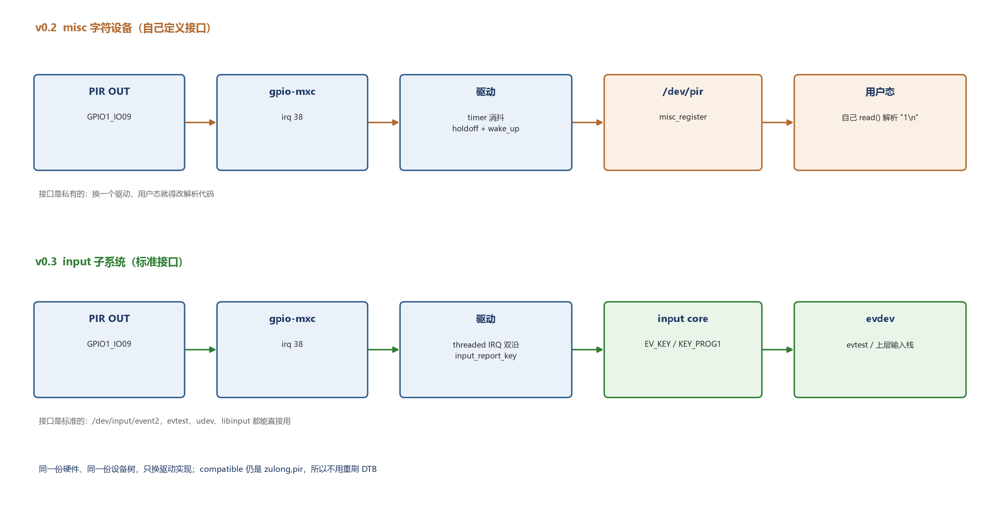

# i.MX6ULL 驱动笔记（02）：PIR 为什么不该做成字符设备——换成 input 子系统

> 系列目录：[00 这个系列写什么](b00-overview.md)
> 上一篇：[01 把 `insmod` 的 gpio_num 换成设备树](https://blog.csdn.net/longlin101/article/details/170550878)
> 代码：[imx6ull-dht22-pir-drivers](https://github.com/longlin05/imx6ull-dht22-pir-drivers)
> 前置：[09 i.MX6ULL 驱动：DHT22 IIO + PIR 字符设备](https://blog.csdn.net/longlin101/article/details/170347113)

---

## 0. 本来想写 IIO 触发缓冲

01 之后，DHT22 能通过设备树 probe、`cat` 一次读一次了。下一步自然是 IIO 的
**触发缓冲**：定时器每 2 秒触发一次采样，用户态从 `/dev/iio:device0` 连续读，
而不是反复 `cat` sysfs。

动手前先摸了个底——这块板子的内核压根没编这套机制：

```bash
$ zcat /proc/config.gz | grep -E "^CONFIG_IIO"
CONFIG_IIO=y
# CONFIG_IIO_BUFFER is not set
# CONFIG_IIO_TRIGGER is not set
```

`IIO_BUFFER` 和 `IIO_TRIGGER` 都是 `not set`，IIO 只剩 direct mode。
也就是说：**不是我没用 buffer，是这个内核没有 buffer**。

## 1. 为什么不为此重编内核

理论上可以：`/proc/config.gz` 有完整配置，打开这两个选项，重编 zImage 刷进去。

但有几个硬问题：

```text
1. 手头只有 NXP 原版树，不是板子厂商的构建树
   （01 里说过，这棵树是用来取 Module.symvers 的）
2. DTB 我们改的时候能做到"diff 只有新增 26 行"，内核编出来没法这样验证
3. 板子没有 i.MX6ULL 的串口控制台，刷坏了只能拔 SD 卡
```

改 DTB 出问题还能用读卡器救回来，改内核出问题救起来麻烦得多。为了写一篇文章
去动厂商内核，收益和风险不成比例，所以这条线到此为止。

**这一步本身就是个结论**：先查 config 再定方案，比写完代码发现编不出来省时间。

## 2. 那换哪个子系统

PIR 上报的本质是"有人经过"这个事件，不是某个读数。所以除了自己造字符设备，
还有 `input` 子系统这条路：

```bash
$ zcat /proc/config.gz | grep -E "^CONFIG_(INPUT|INPUT_EVDEV)="
CONFIG_INPUT=y
CONFIG_INPUT_EVDEV=y
```

板上还有现成的 `evtest`（`/usr/bin/evtest`），另外 `gpio_keys@0`
本来就是 input 设备（`event1`）——说明这条路在这块板子上是通的。



对比很直接：

```text
v0.2  misc_register → /dev/pir → 用户态自己 read() 解析 "1\n"
v0.3  input_register_device → /dev/input/event2 → evtest / udev / libinput 直接用
```

设备树和驱动的关系也没变：硬件描述还是原来那个节点，换的只是驱动实现。

## 3. 驱动怎么写

中断部分沿用 01 的做法：threaded IRQ、双沿、线程里睡消抖时间再读电平。

```c
static irqreturn_t pir_hardirq(int irq, void *data)
{
    return IRQ_WAKE_THREAD;
}

static irqreturn_t pir_thread(int irq, void *data)
{
    struct pir_state *st = data;
    int value;

    msleep(debounce_ms > 0 ? debounce_ms : 1);
    value = gpiod_get_value(st->out);

    if (value && !st->pressed) {
        if (!holdoff_ms ||
            time_after(jiffies, st->last_event + msecs_to_jiffies(holdoff_ms))) {
            st->last_event = jiffies;
            st->pressed = true;
            input_report_key(st->input, key_code, 1);
            input_sync(st->input);
        }
    } else if (!value && st->pressed) {
        st->pressed = false;
        input_report_key(st->input, key_code, 0);
        input_sync(st->input);
    }

    return IRQ_HANDLED;
}
```

和 01 相比只多了两件事：把 `wake_up_interruptible` 换成 `input_report_key` +
`input_sync`，以及"按下了就不能重复按"的状态机（`pressed`）。

probe 里注册输入设备：

```c
st->input = devm_input_allocate_device(&pdev->dev);
st->input->name = "pir";
st->input->phys = "pir/input0";
st->input->id.bustype = BUS_HOST;
st->input->dev.parent = &pdev->dev;

input_set_capability(st->input, EV_KEY, key_code);   /* 默认 KEY_PROG1 */
input_register_device(st->input);

devm_request_threaded_irq(&pdev->dev, st->irq, pir_hardirq, pir_thread,
                          IRQF_TRIGGER_RISING | IRQF_TRIGGER_FALLING | IRQF_ONESHOT,
                          "pir", st);
```

`key_code` 做成了模块参数（默认 `KEY_PROG1`，148），想换成别的按键不用改代码。

## 4. 用户态差多少

v0.2 的用法：

```c
int fd = open("/dev/pir", O_RDONLY);
char buf[8];
read(fd, buf, sizeof(buf));      /* 阻塞到一次事件，内容是 "1\n" */
/* 自己解析字符串、自己处理 EAGAIN、自己写 poll */
```

v0.3 什么都不用写：

```bash
$ evtest /dev/input/event2
Input device name: "pir"
Supported events:
  Event type 0 (EV_SYN)
  Event type 1 (EV_KEY)
    Event code 148 (KEY_PROG1)
```

这就是"标准接口"的实际价值：**任何能读 evdev 的程序都能直接用这个设备**，
不需要为你的驱动写专门的解析代码。Android 的输入栈、libinput、桌面环境的
"按键映射"都是这条链路。

## 5. 事件语义：按下和抬起成对

`input` 里的按键是有状态的：`1` 是按下，`0` 是抬起。所以驱动要做的是
**把电平变化翻译成一对事件**，而不是每来一次中断就报一次。

```text
上升沿（消抖后仍为高）→ input_report_key(1) + input_sync()
下降沿（消抖后为低）  → input_report_key(0) + input_sync()
```

`holdoff` 的用处是压住"一次动作里的重复触发"：如果 3 秒内又检测到上升沿，
不报按下——也就不存在后面的抬起，事件永远是成对的。

这里有个容易写错的细节：如果把 `holdoff` 判断放在"报按下"里，却没管
`pressed` 状态，被压掉的那次动作之后仍会来一个下降沿，于是报出一个
**没有对应按下的抬起**。用 `pressed` 做闸门，这个孤儿事件就不可能发生。

## 6. 实测

加载：

```text
[ 1538.409284] input: pir as /devices/platform/pir/input/input3
[ 1538.436094] pir-input pir: probed, irq=38, key=148, from device tree

$ grep -A5 'Name="pir"' /proc/bus/input/devices
N: Name="pir"
P: Phys=pir/input0
S: Sysfs=/devices/platform/pir/input/input3
H: Handlers=kbd event2
B: PROP=0
```

`evtest` 90 秒窗口里抓到 7 对事件：

```text
Event: time 1794058626.541986, type 1 (EV_KEY), code 148 (KEY_PROG1), value 1
Event: time 1794058626.541986, -------------- SYN_REPORT ------------
Event: time 1794058627.581936, type 1 (EV_KEY), code 148 (KEY_PROG1), value 0
Event: time 1794058627.581936, -------------- SYN_REPORT ------------
...（共 7 对）
```

原始日志用 python 解析后：

```text
按下 / 抬起次数     7 / 7（成对，没有孤儿抬起）
按下次间隔          14.29  3.20  3.38  4.49  4.22  3.12 秒
按下到抬起时长      1.04  1.04  1.04  1.04  1.04  1.05  1.04 秒
```

两条结论是从数字里读出来的，不是猜的：

```text
最小间隔 3.12 s ≥ holdoff 3 s   → holdoff 真的在起作用
按下时长稳定在 1.04 s           → 和 HC-SR501 输出高电平宽度一致，
                                  说明驱动没有凭空造事件
```

rmmod → insmod 一轮：

```text
[ 1675.143379] pir: unloaded
[ 1676.185805] input: pir as /devices/platform/pir/input/input4
[ 1676.196642] pir-input pir: probed, irq=38, key=148, from device tree
```

`input3` 变成 `input4`，说明旧输入设备被 devm 回收后重新注册；
`event2` 编号被复用（`event0` 是 snvs-powerkey，`event1` 是 gpio_keys）。
dmesg 无 warn / oops。

## 7. 几个细节

**为什么 `Handlers=kbd`**

上报 `EV_KEY` 的设备，内核会按键盘类挂一个 `kbd` handler。这会影响
`evtest` 选设备时看到的名字，但读事件走的是 `eventX`，不冲突。
如果只想要原始事件流，可以换 `EV_SW`（开关量）或自定义 `EV_ABS`，
但那样上层就没有现成的"按键"语义可用了——**这里选 `EV_KEY` 是个取舍**。

**为什么复用 `zulong,pir` 这个 compatible**

硬件描述没变（GPIO1_IO09、pinctrl、双沿中断），变的只是驱动实现。
所以新驱动的 `of_match_table` 里同时放 `zulong,pir` 和 `zulong,pir-input`，
**不用重新刷 DTB**，换一个 `.ko` 就能对比新旧两版行为。

**`KEY_PROG1` 是什么**

`input` 里没有"人体红外"这种标准按键，`KEY_PROG1`～`KEY_PROG4` 是留给
用户自定义的通用键值。真做产品时，上层应该有程序把它映射成业务事件。

## 8. 小结

```text
想做的事：IIO buffer        → 内核没编，放弃（先查 config 是对的）
实际做的事：misc → input    → 标准接口、可演示、不需要动内核
代价：一行代码没少写，但用户态少了一整套自定义协议
```

顺带说一句，这一篇能成立，靠的不是"我会 input 子系统"，
而是**先确认环境支不支持**：`/proc/config.gz` 里那两行 `not set`，
比写完 300 行 buffer 代码再发现编不出来要省事得多。

下一篇计划：Buildroot 集成，让这两个模块开机自动加载，不再是手动 `insmod`。

---

标签：`Linux` `i.MX6ULL` `input 子系统` `evdev` `字符设备` `内核模块`
