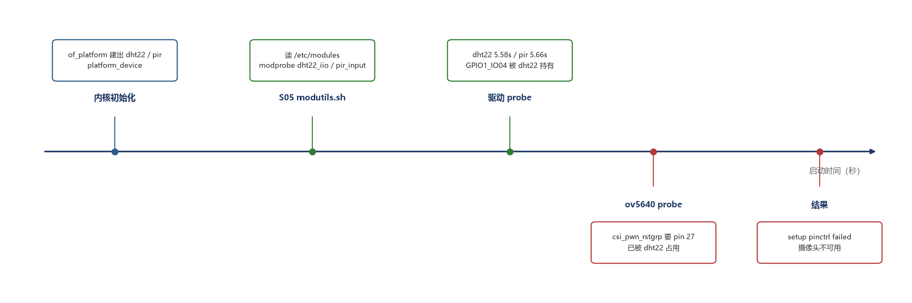

# i.MX6ULL 驱动笔记（03）：从手动 insmod 到开机自动加载——以及它暴露的引脚冲突

> 系列目录：[00 这个系列写什么](b00-overview.md)
> 上一篇：[02 PIR 为什么不该做成字符设备——换成 input 子系统](https://blog.csdn.net/longlin101/article/details/170741777)
> 代码：[imx6ull-dht22-pir-drivers](https://github.com/longlin05/imx6ull-dht22-pir-drivers)
> 前置：[09 i.MX6ULL 驱动：DHT22 IIO + PIR 字符设备](https://blog.csdn.net/longlin101/article/details/170347113)

---

## 0. 手动 insmod 的三个问题

01、02 之后驱动都能跑了，但每次开机还是要敲：

```bash
insmod /home/root/dht22_iio/dht22_iio.ko
insmod /home/root/pir_input/pir_input.ko
```

问题不在麻烦，在于：

```text
1. 重启就没了 —— 板子断电恢复后传感器是"死"的
2. 路径依赖 —— .ko 放在 /home/root 下，谁清理了 home 就没了
3. 参数散落 —— 将来要调 key_code、holdoff 就得改启动脚本
```

这一篇要做的是让它们开机自动加载。原本想的是"集成进 Buildroot"，
摸底之后发现得换方案——**先看这块板子的根文件系统到底是谁编的**。

## 1. 先搞清楚 rootfs 是哪来的

```bash
$ cat /etc/issue
Freescale i.MX Release Distro 4.1.15-2.1.0

$ ls -l /sbin/init
/sbin/init -> init.sysvinit

$ for t in opkg rpm dpkg apt-get; do command -v $t || echo "$t: 没有"; done
opkg: 没有
rpm: 没有
dpkg: 没有
apt-get: 没有
```

结论：

```text
Yocto 编的（不是 Buildroot），sysvinit（不是 systemd），没有包管理器
```

所以"写一个 Buildroot 的 .mk 把它包进去"这条路在这个镜像上**验证不了**——
写了也只能停在纸上，不符合这个系列"没跑过不算数"的规矩。

换个思路：Yocto 镜像里其实就带着模块加载机制。

## 2. modutils.sh 到底怎么工作

```bash
$ ls /etc/rcS.d/ | grep -i modul
S05modutils.sh
```

脚本里最关键的一段：

```sh
LOAD_MODULE=modprobe
[ -f /proc/modules ] || exit 0
[ -f /etc/modules ] || [ -d /etc/modules-load.d ] || exit 0

if [ ! -f /lib/modules/`uname -r`/modules.dep ]; then
	depmod -Ae
fi

process_file() {
	file=$1
	(cat $file; echo; ) |
	while read module args
	do
		case "$module" in
			\#*|"") continue ;;
		esac
		eval "$LOAD_MODULE $module $args >/dev/null 2>&1"
	done
}
```

翻译成一句话：**开机时读 `/etc/modules`，每一行当作 `modprobe` 的参数**。
所以要做的事只有三件：

```text
1. .ko 放到 /lib/modules/$(uname -r)/extra/
2. depmod -a  （modprobe 按模块名查找，靠 modules.dep）
3. 模块名写进 /etc/modules
```

## 3. 实施

驱动仓库的 Makefile 补了 `install` 目标，走内核自己的 `modules_install`：

```make
install:
	$(MAKE) -C $(KDIR) M=$(CURDIR) ARCH=$(ARCH) CROSS_COMPILE=$(CROSS_COMPILE) \
		INSTALL_MOD_PATH=$(INSTALL_MOD_PATH) modules_install
```

交叉编译时装进一个暂存目录，再整体拷到板子：

```bash
make -C drivers/dht22_iio install INSTALL_MOD_PATH=/tmp/stage
# → /tmp/stage/lib/modules/4.1.15-g3dc0a4b/extra/dht22_iio.ko
```

板子上：

```bash
mkdir -p /lib/modules/$(uname -r)/extra
cp dht22_iio.ko pir_input.ko /lib/modules/$(uname -r)/extra/
depmod -a
```

`depmod` 之后再查就认得模块名了：

```bash
$ grep -E "dht22_iio|pir_input" /lib/modules/$(uname -r)/modules.dep
extra/dht22_iio.ko:
extra/pir_input.ko:
```

然后写 `/etc/modules`：

```text
# i.MX6ULL 传感器驱动（B 系列）
dht22_iio
pir_input
```

注意这里写的是**模块名，不是路径**——`modprobe` 会按 `modules.dep` 去找，
这也是为什么要先 `depmod`。

## 4. 重启验证

```text
[    5.583432] dht22 dht22: probed, from device tree
[    5.624236] input: pir as /devices/platform/pir/input/input3
[    5.661232] pir-input pir: probed, irq=38, key=148, from device tree
```

```bash
$ cat /sys/bus/iio/devices/iio:device0/in_temp_input
20000
$ grep -A4 'Name="pir"' /proc/bus/input/devices
N: Name="pir"
H: Handlers=kbd event2
```

两个模块都在开机 5.6 秒左右自己起来了，不用敲任何命令。

## 5. 副作用：probe 顺序变了，冲突暴露出来

同一段 dmesg 往下几行，出现了以前从没见过的报错：

```text
[    6.245036] imx6ul-pinctrl 20e0000.iomuxc: pin MX6UL_PAD_GPIO1_IO04 already
              requested by dht22; cannot claim for 1-003c
[    6.381399] imx6ul-pinctrl: could not request pin 27 (MX6UL_PAD_GPIO1_IO04)
              from group csi_pwn_rstgrp on device 20e0000.iomuxc
[    7.017751] ov5640 1-003c: setup pinctrl failed
```



翻设备树就明白了：

```dts
ov5640@3c {
    compatible = "ovti,ov5640";
    pwn-gpios = <&gpio1 4 GPIO_ACTIVE_LOW>;   /* 和 DHT22 同一个脚 */
    rst-gpios = <&gpio1 2 0>;
    status = "okay";
};
```

**GPIO1_IO04 是摄像头的 power-down 脚。** DHT22 在 5.58 秒先占住，
摄像头 6.4 秒再来申请就被拒——`csi_pwn_rstgrp` 整组 pinctrl 都应用失败。

之前手动 insmod 时从没报过这个错，因为加载时机在人手里：
摄像头早 probe 完了，该失败的失败、该放手的放手，DHT22 再去拿就是"没人要的脚"。
**自动加载把这件事交给内核，时序假设全部被打破。**

## 6. 为什么 01 里没发现

01 选脚的时候我查过运行时状态：

```bash
$ grep -E "pin (27|32) " /sys/kernel/debug/pinctrl/20e0000.iomuxc/pinmux-pins
pin 27 (MX6UL_PAD_GPIO1_IO04): (MUX UNCLAIMED) (GPIO UNCLAIMED)
pin 32 (MX6UL_PAD_GPIO1_IO09): (MUX UNCLAIMED) (GPIO UNCLAIMED)
```

**`MUX UNCLAIMED` 只表示"此刻没被驱动持有"，不表示"设备树里没别的节点要用它"。**
摄像头当时没 probe 成功，所以脚是空的；等它 probe 时，脚已经被我们拿走了。

正确的查法要两边都看：

```bash
# 运行时：谁现在占着
/sys/kernel/debug/pinctrl/20e0000.iomuxc/pinmux-pins

# 静态：设备树里谁声明要用
grep -n "<0x08 0x" board.dts      # 0x08 是 gpio1 的 phandle
```

这块板子 GPIO1 那一组的实际归属：

| 丝印 | GPIO1_IO | 占用者 |
|---|---|---|
| GPIO_1 | IO01 | 厂商 `dht11`/`ds18b20` 示例节点（无驱动绑定） |
| GPIO_2 | IO02 | 摄像头 `rst-gpios` |
| GPIO_3 | IO03 | 板载 LED |
| GPIO_4 | IO04 | 摄像头 `pwn-gpios` ← DHT22 在这 |
| GPIO_5 | IO05 | pinctrl hog |
| GPIO_6/7 | IO06/07 | 网口 ENET2 |
| GPIO_8 | IO08 | PWM 背光 |
| GPIO_9 | IO09 | 触摸屏 IRQ ← PIR 在这 |

我们两个传感器都"借"了 LCD 模块的脚。

## 7. 怎么处理（以及我为什么暂时不动）

```text
方案 A  把 DHT22 挪到 GPIO1_IO01（全组唯一空脚），动一根线
        → 摄像头完全不受影响；代价是重新接线段、重建 DTB、再重启验证
方案 B  设备树里把 ov5640 节点 disable
        → 不用动线，但摄像头就真的不能用了
方案 C  保持现状，把冲突记录下来
```

我选了 C，原因很实际：这块板子的摄像头不是这两个项目的一部分，
而**"把已知问题写清楚"比"为了消除报错去隐藏一个设备"更诚实**。

如果以后要用摄像头，恢复步骤也写进仓库 README 了：

```text
1. DHT22 DATA 从 GPIO_4 挪到 GPIO_1
2. 设备树 data-gpios 改 <&gpio1 1 0>，pinctrl 改 0x60 0x2ec
3. 摄像头节点不用动
```

## 8. 小结

```text
开机自动加载      /lib/modules/extra + depmod + /etc/modules（本镜像原生方式）
顺带发现的        probe 顺序改变会打破"手动加载时代"的隐含假设
真正的教训        MUX UNCLAIMED ≠ 这个脚没人声明过
```

这一篇最值钱的不是 `/etc/modules` 怎么写（三行的事），
而是它把 01 里埋的坑炸了出来——**顺序一变，隐藏的资源竞争就藏不住了**。
手动加载的时候，人其实在替系统做资源仲裁，还做得毫无知觉。

下一篇计划：把 DHT22 的读数做成可观测的（错误计数、超时统计），
或者回到项目 A 线补 UDS 的 `0x27 SecurityAccess`。

---

标签：`Linux` `i.MX6ULL` `内核模块` `modprobe` `sysvinit` `设备树`
